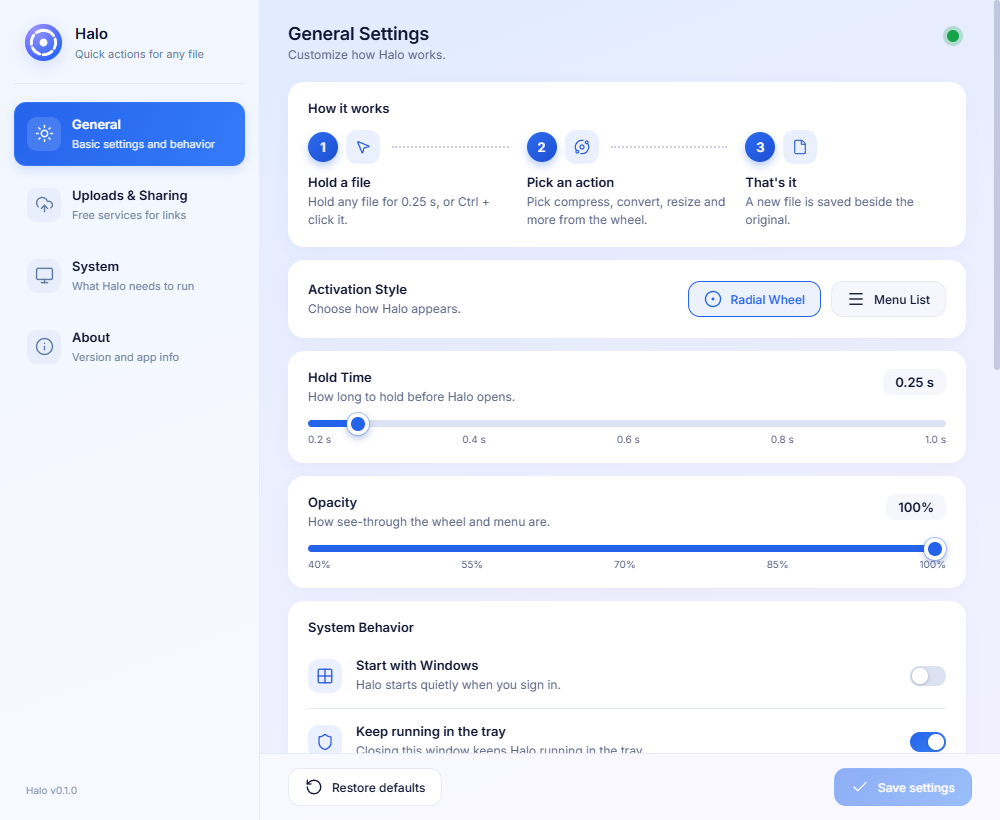

<div align="center">


# Halo

### Your files. One wheel. Less friction.

Compress, convert, resize, share and record your screen from a lightweight Windows desktop app.

[](https://github.com/ssanaullahrais/Halo/releases/latest)
[](https://github.com/ssanaullahrais/Halo/actions/workflows/release.yml)


[**Download Halo**](https://github.com/ssanaullahrais/Halo/releases/latest) · [Report an issue](https://github.com/ssanaullahrais/Halo/issues) · [Changelog](CHANGELOG.md) · [Build from source](#build-from-source)

</div>

---

## A shortcut between your file and your next step

Hold a file, open Halo and choose an action. A radial wheel keeps the essentials close; a compact menu offers the same tools in a familiar list. Halo adapts the available actions to the selected file and the engines installed on your PC.

Opening Halo from the tray works too: choose an action, select a file and let Halo handle the next step.

<div align="center">

</div>

## What you can do

| Feature | What it offers |
| --- | --- |
| **Quick file actions** | Compress, convert, resize, rotate, copy, rename and organize supported files. |
| **Two ways to work** | Switch between the radial wheel and a compact menu. |
| **Screen recording** | Capture a display, an individual window or a selected region. |
| **Audio** | Record microphone and system audio, with separate controls. |
| **Annotations** | Add arrows, rectangles, text and blur; select, move, resize or remove individual drawings. Drawing changes appear over time in exports. |
| **Cursor presentation** | Keep the original pointer or choose highlights, spotlight, a fading trail and click effects. |
| **Presentation frames** | Export with a macOS or Windows-style frame and keep a separate original without the frame. |
| **Uploads & sharing** | Upload selected files through enabled third-party providers and copy their links. |
| **Updates** | Download signed releases automatically; choose Update & restart when your work is finished. |

## Download

Requires **64-bit Windows 10 or Windows 11**, Microsoft Edge WebView2 and compatible graphics drivers for recording. Halo is currently Windows-only.

| Download | Choose this for |
| --- | --- |
| `Halo_*_x64-setup.exe` | A normal desktop installation. Recommended. |
| `Halo_*_x64_en-US.msi` | Windows Installer and managed deployments. |

Get installers from [GitHub Releases](https://github.com/ssanaullahrais/Halo/releases). The app checks update signatures before accepting an update. This is separate from Windows publisher signing; Windows may show an unknown-publisher warning for an installer without an Authenticode certificate.

## Getting started

1. Launch Halo and choose **Radial Wheel** or **Menu List** in Settings.
2. Hold a supported file, use **Ctrl + click**, or press the configured shortcut.
3. Choose an action. Halo generally creates a separate output instead of changing your source.
4. Open Halo from the tray when you want to choose an action before selecting a file.

The default file shortcut is **Ctrl + Alt + H**. Screen recording has its own **Ctrl + Alt + R** shortcut. Both can be changed.

### Record your screen

Open the recorder from Halo or the tray. Select **Screen**, **Window** or **Area**, then click **Record**. In Area mode, drag the region and release to begin. Use **Esc** to cancel selection.

The toolbar provides pause/resume, finish, microphone and system-audio controls. Click the active recording button again to finish. The drawing toolbar supports individual selection, Delete/Backspace, dragging and resizing. Recording settings live behind the recorder's gear button.

Original-resolution recording supports 30 or 60 fps. Actual capture smoothness and encoding speed depend on the source, hardware and graphics driver. Audio exports at 48 kHz. If a mockup frame is selected, Halo saves both the framed video and an original without the frame.

## Formats and optional engines

- **Images:** common formats including JPEG, PNG, WebP, AVIF, BMP, TIFF, GIF and ICO. Some formats and animations offer different actions.
- **Video & audio:** FFmpeg powers supported conversion, compression, resizing and recording routes.
- **PDFs:** PDFium handles page rendering, text and embedded-image extraction. Rendering a PDF page and extracting its original embedded pictures are different actions.
- **Documents:** available routes depend on the document type and installed engines. Microsoft Edge supports selected document-to-PDF paths; Office routes require a functioning compatible installation.
- **PSD/PSB and extended images:** optional ImageMagick handles composite decoding. Halo does not offer Photoshop-equivalent layer editing.

Open **Settings → System** to see which components are ready and which need setup. Available menu options reflect capabilities; the app does not promise every possible input/output combination.

The standard Explorer context-menu entry can be enabled in Settings. On Windows 11 it is available under **Show more options**. Experimental first-menu package tooling lives under `packaging/` and requires separate registration.

## Updates

Installed release builds check GitHub after startup and every four hours. A new release downloads in the background and is verified using Halo's update-signing public key. Open **Settings → About** to check manually or choose **Update & restart**.

Halo blocks installation while a recording, export, conversion or upload is running. It does not restart in the middle of your work. Development builds do not automatically check for updates.

## Privacy

File processing and recording happen locally. Enabling an upload action sends the selected files to the third-party provider you chose. Update checks contact GitHub; optional engine installation downloads the required engine. Halo needs no account for its local tools.

Review files and provider retention policies before uploading sensitive content.

## Build from source

Install Node.js 22, Rust stable, the Visual Studio C++ build tools and the [Tauri Windows prerequisites](https://v2.tauri.app/start/prerequisites/).

```powershell
git clone https://github.com/ssanaullahrais/Halo.git
cd Halo
npm ci
npm run tauri dev
```

Run the relevant checks:

```powershell
node scripts/check-version.mjs
npm run build
cargo test --locked --manifest-path src-tauri/Cargo.toml
```

Create installers:

```powershell
$env:TAURI_SIGNING_PRIVATE_KEY = 'C:\secure\halo-updater.key'
npm run tauri build -- --locked
```

Installers are written to `src-tauri/target/release/bundle/`. Keep private signing keys outside the repository. See [the release guide](docs/RELEASING.md) for version tags, GitHub secrets and publishing.

## Built with

Tauri 2 · Rust · JavaScript · Vite · Lucide · Inter · FFmpeg · PDFium · optional ImageMagick

Third-party components retain their own licences and notices. See [THIRD_PARTY_NOTICES.txt](THIRD_PARTY_NOTICES.txt) and bundled resource notices. FileConverter source code has not been copied into Halo.

---

<div align="center">
Made by <a href="https://github.com/ssanaullahrais">Sanaullah Rais</a> · <a href="https://github.com/ssanaullahrais/Halo/issues">Feedback and bug reports</a>
</div>
