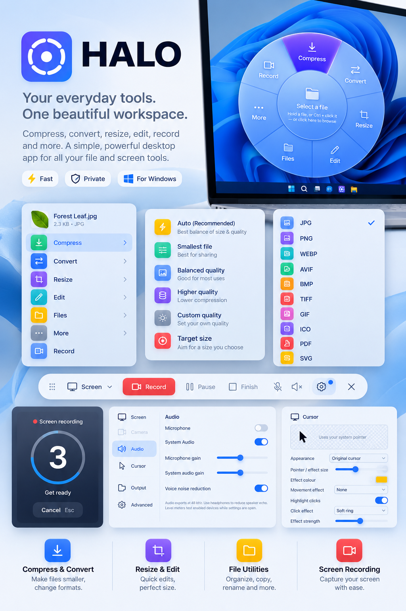

<div align="center">


# Halo

**Quick file actions and screen recording for Windows.**

Compress · Convert · Resize · Edit · Share · Record — all from one radial wheel, one tray icon and two shortcuts.

[](https://github.com/ssanaullahrais/Halo/releases/latest)
[](https://github.com/ssanaullahrais/Halo/releases)
[](#download)
[](https://tauri.app)

[Download](#download) · [File tools](#file-tools) · [Screen recording](#screen-recording) · [Privacy](#privacy) · [Build from source](#build-from-source)

</div>

<p align="center">
  
</p>

---

## Why Halo?

Everyday file jobs usually mean opening a heavy app, hunting for a website, or uploading a private file to a stranger's server. Halo puts them one gesture away: hold a file, pick an action, done. You can also open Halo from the tray, choose an action, then select your file.

The same app records your screen, with drawing tools and cursor effects that are baked into the saved video, so you can go from capture to a shareable clip without a second program.

## File tools

| Action | Options |
| --- | --- |
| **Compress** | Auto, smallest file, balanced quality, higher quality, custom quality and image target size. Create ZIP archives for files and folders. |
| **Convert** | Images, video, audio, PDFs and supported documents. Available formats are listed below. |
| **Resize** | Custom dimensions, social media, wallpaper, email and percentage presets. |
| **Edit** | Preview, rotate left/right, flip horizontally/vertically, remove metadata, extract audio and set an image as wallpaper. Extract embedded pictures from PDFs. |
| **Files** | Copy, duplicate, copy path, Base64, image-to-text OCR, move, rename, open location, open in a new window and check file type. |
| **More** | Upload and copy a link, create ZIP, extract ZIP, open with another app, create QR code, view properties and move to the Recycle Bin. |

Options adapt to the file you select. Not every action applies to every format.

### Conversion formats

| Type | Open these formats | Convert to |
| --- | --- | --- |
| **Images** | JPG/JPEG/JFIF, PNG, WebP, AVIF, BMP, GIF, TIFF/TIF, ICO | JPG, PNG, WebP, AVIF, BMP, TIFF, GIF, ICO, PDF and an SVG containing the image |
| **Extended images** | PSD, PSB, TGA, DDS, EXR with the optional image engine | Supported image outputs and PDF |
| **Vector images** | SVG | PNG, JPG, WebP, AVIF, BMP, TIFF, GIF, ICO, PDF |
| **Video** | MP4, MOV, MKV, AVI, WebM, M4V, WMV, FLV, 3GP/3GPP, MPEG/MPG, OGV, TS, VOB, RM | MP4, WebM, MKV, MOV, AVI, OGV, GIF, or supported audio formats |
| **Audio** | MP3, WAV, FLAC, OGG/OGA, M4A/M4B, AAC, WMA, Opus, AIFF | MP3, WAV, OGG, FLAC, M4A, AAC, Opus |
| **PDF** | PDF | PNG, JPG, WebP, TIFF, BMP, GIF, AVIF, ICO, TXT, DOCX, HTML, Markdown |
| **Documents** | TXT, Markdown, HTML, DOCX, CSV, LOG, JSON, XML | Available document and image outputs depend on the source and installed engines |

Animated GIFs have separate animation-preserving options. Document conversion depends on the format and installed software. **Settings → System** shows the components available on your PC.

## Screen recording

- Record a **screen, window or selected area** at original resolution, with 30 or 60 fps options.
- Capture **microphone and system audio**, with separate controls.
- **Pause, resume and finish** from the movable recording toolbar.
- Draw **arrows, boxes, text and blur**. Select, move, resize and delete individual drawings.
- Drawing and editing changes appear over time in the saved video.
- Choose the original pointer, highlights, spotlight, fading trail and click effects.
- Add a **macOS or Windows frame** while keeping a separate original video without the frame.

Choose **Area → Record**, drag your region and release to begin. Press **Esc** to cancel selection. Recording quality and smoothness depend on your hardware and graphics driver.

## Download

Get the latest installer from the **[Releases page](https://github.com/ssanaullahrais/Halo/releases/latest)**.

| File | Use it when |
| --- | --- |
| x64 setup `.exe` | You want the normal installer (recommended) |
| `.msi` | You deploy with Windows Installer or Group Policy |

Requires **64-bit Windows 10 or 11** and the WebView2 runtime. FFmpeg powers video, audio and recording. Optional engines can be checked in **Settings → System**.

> **Updates are automatic.** Halo checks GitHub in the background and verifies signed downloads. Open **Settings → About** to check manually or choose **Update & restart**. Installation is blocked while a recording, conversion or upload is running.

## Keyboard shortcuts

| Keys | Action |
| --- | --- |
| `Ctrl` + `Alt` + `H` | Open Halo |
| `Ctrl` + `Alt` + `R` | Start recording |
| `Esc` | Cancel area selection |

Both global shortcuts are configurable in Settings.

## Privacy

Files and recordings are processed **locally**. Upload actions send the selected files to the provider you enabled, and only when you choose them. Update checks contact GitHub; optional engine installation downloads the required component.

## Code signing

Update downloads carry a separate updater signature that Halo checks before installing. Update signatures are not Windows publisher certificates, so Windows may show an unknown-publisher warning for the installer. Every release is built from this repository by the [release workflow](.github/workflows/release.yml).

## Build from source

You need Node.js 22, Rust stable and the [Tauri Windows prerequisites](https://v2.tauri.app/start/prerequisites/).

```powershell
git clone https://github.com/ssanaullahrais/Halo.git
cd Halo
npm ci
npm run tauri dev      # run with hot reload
npm run tauri build    # build the installers
```

See [the release guide](docs/RELEASING.md) for building signed installers and [the changelog](CHANGELOG.md) for what changed in each version.

## Tech stack

[Tauri 2](https://tauri.app) · Rust · React 19 · Vite · FFmpeg · [Lucide](https://lucide.dev) · Inter

---

<div align="center">
<sub>Made by <a href="https://github.com/ssanaullahrais">Sanaullah Rais</a> · <a href="https://github.com/ssanaullahrais/Halo/issues">Report an issue</a></sub>
</div>
